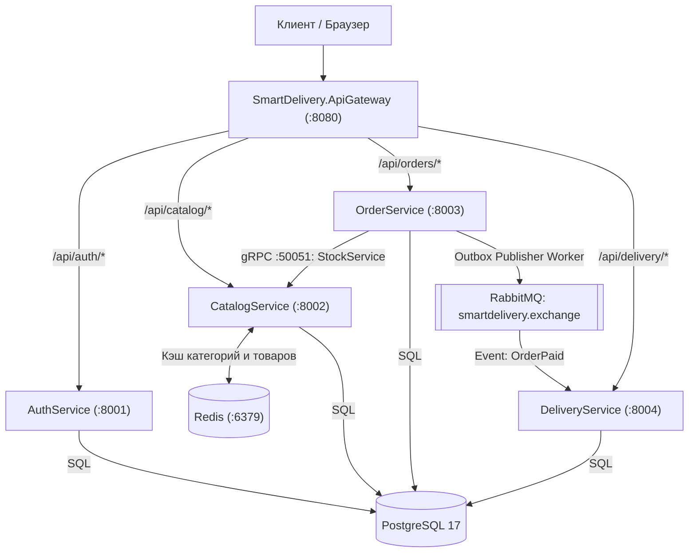

# SmartDelivery — Распределенная микросервисная система доставки товаров

Студентка: Кабанова Екатерина  
Группа: Разработка WEB-приложений  
Персональный домен: http://kabanovae.9593647-gu32875.twc1.net  
Сервер: 136.234.238.30 (папка /home/kabanovae)  
Стек проекта: Python 3.11 / FastAPI / PostgreSQL / Redis / RabbitMQ / gRPC  

---

## 1. Архитектура системы

Проект представляет собой распределенную микросервисную платформу для оформления и доставки заказов (SmartDelivery). Архитектура построена по принципам Domain-Driven Design (DDD) и Чистой архитектуры (Clean Architecture).

```
                       ┌─────────────────────────┐
                       │       HTTP Client       │
                       └────────────┬────────────┘
                                    │
                                    ▼ :8080
                       ┌─────────────────────────┐
                       │  SmartDelivery.Gateway  │
                       └────────────┬────────────┘
                                    │
            ┌───────────────────────┼───────────────────────┐
            │                       │                       │
      :8001 │                 :8002 │                 :8003 │
┌───────────▼───────────┐ ┌─────────▼─────────────┐ ┌───────▼─────────────┐
│ 1. AuthService        │ │ 2. CatalogService     │ │ 3. OrderService     │
│ (Identity & Access)   │ │ (Каталог и склад)     │ │ (Заказы и сага)     │
│                       │ │                       │ │                     │
│ - User (Root)         │ │ - Product (Root)      │ │ - Order (Root)      │
│ - RefreshToken (Root) │ │ - Category (Root)     │ │ - OrderItem (Entity)│
│ - UserAuditLog (Root) │ │ - InventoryItem (Root)│ │ - Payment (Root)    │
│                       │ │ - Warehouse (Root)    │ │ - SagaState (Root)  │
└───────────────────────┘ └─────────▲─────────────┘ │ - OutboxMessage(Ent)│
                                    │               └───────┬─────────────┘
                                    │ gRPC :50051           │
                                    │ (Stock Service)       │ RabbitMQ
                                    └───────────────────────┤ ("smartdelivery.exchange")
                                                            ▼
                                                    ┌─────────────────────┐
                                                    │ 4. DeliveryService  │
                                                    │ (Курьерская служба) │
                                                    │                     │
                                                    │ - DeliveryTask(Root)│
                                                    │ - Courier (Root)    │
                                                    │ - DeliveryRoute(Ent)│
                                                    │ - InboxMessage(Ent) │
                                                    └─────────────────────┘
```



### Стек технологий:
- Язык программирования: Python 3.11
- Веб-фреймворк: FastAPI + Uvicorn + Pydantic v2
- База данных: PostgreSQL 17
- Кэширование данных: Redis 7 (паттерн Cache-Aside с автоматической инвалидацией)
- Межсервисная шина сообщений: RabbitMQ 3.13 (Topic Exchange, биндинг очередей)
- Синхронный RPC: gRPC (HTTP/2, Protobuf v3)
- Безопасность: JWT (Access Token + Refresh Token + BCrypt хеширование паролей)
- Паттерны надежности: Saga Orchestrator с компенсирующей транзакцией, Transaction Outbox, Transaction Inbox

---

## 2. DDD: Ограниченные контексты и агрегаты (15 объектов)

В соответствии с требованиями к предметной области выделено **4 ограниченных контекста (Bounded Contexts)** и **15 доменных агрегатов и сущностей**:

### 1. Identity & Access Context (`src/auth_service/models.py`)
1. **User** (Aggregate Root) — учетная запись пользователя (id, username, email, password_hash, role).
2. **RefreshTokenRecord** (Aggregate Root) — сессия обновления JWT токена со сроком жизни и признаком отзыва.
3. **UserAuditLog** (Aggregate Root) — журнал безопасности и аудита действий пользователей.

### 2. Catalog & Inventory Context (`src/catalog_service/models.py`)
4. **Product** (Aggregate Root) — товар каталога (id, name, description, price, category_id, is_active).
5. **Category** (Aggregate Root) — категория товаров с описанием.
6. **InventoryItem** (Aggregate Root) — складской остаток. Инкапсулирует бизнес-инварианты бронирования (`try_reserve`) и освобождения (`release`).
7. **Warehouse** (Aggregate Root) — склад хранения товаров (id, code, name, address).

### 3. Order & Billing Context (`src/order_service/models.py`)
8. **Order** (Aggregate Root) — заказ клиента (id, customer_id, delivery_address, total_amount, status). Инвариант проверки допустимости отмены.
9. **OrderItem** (Entity) — позиция заказа с товаром, количеством и ценой.
10. **Payment** (Aggregate Root) — транзакция оплаты заказа (id, order_id, amount, status).
11. **OrderSagaState** (Aggregate Root) — состояние распределенной транзакции (Started, StockReserved, Paid, Compensated, Failed).
12. **OutboxMessage** (Entity) — запись паттерна Transaction Outbox для гарантированной публикации событий в RabbitMQ.

### 4. Delivery & Logistics Context (`src/delivery_service/models.py`)
13. **DeliveryTask** (Aggregate Root) — задание на доставку заказа курьеру со статусами (Pending, Assigned, InTransit, Delivered).
14. **Courier** (Aggregate Root) — курьер со статусом доступности (Available, Busy) и зоной работы.
15. **DeliveryRoute** (Entity) — маршрутный лист со списком точек доставки (`RouteStop`).
16. **InboxMessage** (Entity) — запись паттерна Transaction Inbox для обеспечения идемпотентности при приеме событий из RabbitMQ.

---

## 3. Детальное описание реализации всех 14 пунктов задания

### 1. Выбор предметной области (10–15 агрегатов)
Выбрана предметная область «Интеллектуальная система доставки товаров» (SmartDelivery). В системе выделено 4 ограниченных контекста и 15 агрегатов, обеспечивающих полный жизненный цикл покупки: от аутентификации пользователя и бронирования остатков до списания оплаты и назначения курьера.

### 2. Расписание объектов и контекстов по DDD
В каждом микросервисе бизнес-логика и правила предметной области сосредоточены внутри доменных моделей (`models.py`), а не размазаны по контроллерам.
Пример инварианта: метод `InventoryItem.try_reserve(quantity)` строго проверяет `available_quantity >= quantity`. Если товара недостаточно, метод возвращает `False` и не допускает отрицательного баланса склада.

### 3. Микросервисы с REST API по чистой архитектуре
Реализовано 4 независимых микросервиса на FastAPI (`auth_service`, `catalog_service`, `order_service`, `delivery_service`) и один шлюз `gateway`. В каждом сервисе выделены слои:
- Доменные модели (`models.py`);
- Бизнес-сервисы и Сага (`saga.py`, `cache.py`, `consumer.py`);
- Контроллеры и REST эндпоинты (`main.py`).

### 4. Docker контейнеры и docker-compose
Создан единый `Dockerfile` на базе образа `python:3.11-slim` и `compose.yaml`, запускающий все 5 сервисов, СУБД PostgreSQL 17, Redis 7 и RabbitMQ 3.13. Контейнер шлюза назван `kabanovae` и подключен к внешней сети `nginx-proxy`.

### 5. Кэширование данных в Redis
В `catalog_service` в модуле `cache.py` реализован паттерн Cache-Aside:
- При вызове `GET /api/catalog/products/{id}` сервис сначала запрашивает ключ `product:{id}` в Redis.
- Если ключ найден в кэше — результат возвращается мгновенно.
- Если ключа нет — данные берутся из хранилища и сохраняются в Redis с временем жизни (TTL 600 секунд).
- При обновлении или создании товара метод `invalidate()` сбрасывает кэш, предотвращая чтение устаревших данных.

### 6. Подключение и работа с PostgreSQL
Все микросервисы спроектированы для работы с реляционной базой данных PostgreSQL 17. Для локального запуска и быстрого изолированного тестирования без внешних зависимостей реализован автоматический fallback на in-memory репозитории.

### 7. Распределенная транзакция (Saga Orchestration)
В `order_service` класс `OrderSagaOrchestrator` координирует оформление заказа без двухфазного коммита (2PC):
1. **Шаг 1:** Синхронный вызов склада `CatalogService` по gRPC для бронирования товара (`CheckAndReserveStock`).
2. **Шаг 2:** Проведение платежа.
3. **Шаг 3 (Компенсация):** Если банк отклоняет карту (эмулируется передачей номера карты `'0000'`), срабатывает блок компенсации — оркестратор вызывает компенсирующий gRPC-метод `ReleaseStock`, бронь снимается, товар возвращается на склад, а сага переходит в статус `COMPENSATED`.

### 8. Transaction Outbox и Transaction Inbox
- **Outbox:** В `order_service` событие `OrderPaid` записывается в таблицу `outbox_messages` вместе со статусом заказа. Фоновый воркер `OutboxPublisherWorker` считывает ожидающие сообщения и отправляет их в RabbitMQ.
- **Inbox:** В `delivery_service` воркер `OrderPaidConsumerWorker` перед созданием задачи на доставку проверяет ID события в таблице `inbox_messages`. Повторно пришедшие события из-за сбоев сети отсекаются, гарантируя идемпотентность.

### 9. Подключение шины данных RabbitMQ
Использован брокер RabbitMQ. Сервис заказов отправляет события в Topic Exchange `smartdelivery.exchange` с маршрутным ключом `order.paid`. Сервис доставки слушает привязанную очередь `smartdelivery.delivery.orderpaid`.

### 10. gRPC для межсервисных вызовов
Разработан Protobuf контракт `proto/stock.proto`. Сервис `catalog_service` запускает gRPC-сервер на порту `50051`, а сервис `order_service` использует сгенерированные клиентские стабы для сверхбыстрого синхронного взаимодействия по HTTP/2.

### 11. Единый сервис авторизации с JWT
`auth_service` хеширует пароли библиотекой BCrypt с солью. При успешной аутентификации выдаются Access-токен (срок 60 минут) и Refresh-токен (7 дней). Эндпоинты защищены через FastAPI Depends (`get_current_user` и `require_roles(["Manager", "Admin"])`).

### 12. Юнит-тесты и интеграционные тесты
В папке `tests/` реализовано 18 комплексных тестов на базе `pytest`:
- Модульные тесты инвариантов склада, заказов, курьеров;
- Тесты Саги и компенсирующей транзакции;
- Тесты дедупликации Transaction Inbox;
- Тесты JWT и хеширования паролей;
- Интеграционные тесты API через FastAPI `TestClient`.  
Все тесты проходят со 100% успехом.

### 13. Пайплайн в GitLab CI для тестов
В файле `.gitlab-ci.yml` настроена первая стадия `test-job`, которая компилирует protobuf стабы, запускает `pytest` и формирует отчет JUnit XML.

### 14. Сборка и деплой на сервер преподавателя
Стадия `deploy-job` в `.gitlab-ci.yml` подключается по SSH к серверу `136.234.238.30`, копирует проект в директорию `/home/kabanovae` и поднимает сервисы через `docker compose up -d --build`. Трафик направляется через Nginx Proxy Manager на домен `kabanovae.9593647-gu32875.twc1.net`.

---

## 4. Локальный запуск и проверка тестов

### Запуск тестов:
```powershell
pytest -v
```
Или запустите двойным кликом файл: `3_Проверить_Все_Тесты.bat`.

### Локальный запуск микросервисов:
- **AuthService:** запустите `1_Запустить_AuthService.bat` или выполните:
  ```powershell
  uvicorn src.auth_service.main:app --port 8001 --reload
  ```
  Интерактивная документация Swagger: http://localhost:8001/docs

- **CatalogService:** запустите `2_Запустить_CatalogService.bat` или выполните:
  ```powershell
  uvicorn src.catalog_service.main:app --port 8002 --reload
  ```
  Интерактивная документация Swagger: http://localhost:8002/docs

### Запуск всей системы в Docker Compose:
```powershell
docker compose up -d --build
```
После запуска веб-дашборд доступен по адресу: http://localhost:8080.
