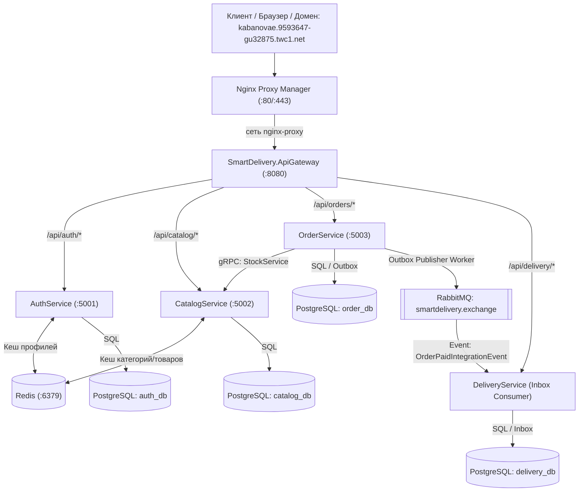

# SmartDelivery — Распределенная микросервисная платформа доставки

**Студент:** Кабанова Екатерина  
**Дисциплина:** Разработка WEB-приложений  
**Целевой результат:** Выполнение всех 14 пунктов практического задания (Автомат)  
**Персональный домен:** `http://kabanovae.9593647-gu32875.twc1.net`  
**Сервер:** `136.234.238.30`  
**Каталог на сервере:** `/home/kabanovae`  

---

## 📌 Оглавление
1. [Архитектура решения](#архитектура-решения)
2. [Подробный отчет по всем 14 пунктам (Шпаргалка к защите)](#подробный-отчет-по-всем-14-пунктам)
3. [Инструкция: Как загрузить проект в GitLab и запустить пайплайн](#пошаговая-инструкция-по-gitlab-и-деплою)
4. [Настройка Nginx Proxy Manager и Portainer](#настройка-nginx-proxy-manager-и-portainer)
5. [Локальный запуск и запуск тестов](#локальный-запуск-и-тестирование)

---

## 🏛 Архитектура решения

Система построена на принципах **Domain-Driven Design (DDD)** и **Чистой архитектуры (Clean Architecture)** с разделением на независимые микросервисы:



---

## 📋 Подробный отчет по всем 14 пунктам

Этот раздел предназначен для того, чтобы уверенно рассказать преподавателю о реализации каждого из пунктов задания:

### Пункт 1: Выбор предметной области (10–15 агрегатов, несколько контекстов)
- **Предметная область:** SmartDelivery — интеллектуальная логистическая система оформления и доставки товаров (маркетплейс доставки).
- **Ограниченные контексты (Bounded Contexts):**
  1. `AuthContext` (Аутентификация и пользователи)
  2. `CatalogContext` (Товары, категории и складские остатки)
  3. `OrderContext` (Заказы, оплаты и сага)
  4. `DeliveryContext` (Курьерская доставка, логистические маршруты)
- **Количество агрегатов (15 агрегатов):**
  1. `User` (пользователи системы)
  2. `RefreshToken` (сессии обновления токенов)
  3. `UserAuditLog` (аудит безопасности)
  4. `Product` (товар каталога)
  5. `Category` (категория товаров)
  6. `InventoryItem` (складской учет и резервы)
  7. `Warehouse` (физический склад)
  8. `Order` + `OrderItem` (заказ клиента)
  9. `Payment` (транзакция оплаты)
  10. `OrderSagaState` (состояние саги распределенной транзакции)
  11. `OutboxMessage` (транзакционный Outbox)
  12. `DeliveryTask` (задание на курьерскую доставку)
  13. `Courier` (профиль и статус курьера)
  14. `DeliveryRoute` + `RouteStop` (маршрутный лист доставки)
  15. `InboxMessage` (транзакционный Inbox для идемпотентности)

### Пункт 2: Описание объектов и контекстов по DDD
- **Файлы реализации:** 
  - `src/Common/SmartDelivery.Shared/Domain/AggregateRoot.cs` — базовый класс корней агрегатов.
  - `src/Services/Auth/SmartDelivery.AuthService/Domain/` — агрегаты контекста Auth.
  - `src/Services/Catalog/SmartDelivery.CatalogService/Domain/` — агрегаты контекста Catalog.
  - `src/Services/Order/SmartDelivery.OrderService/Domain/` — агрегаты контекста Order.
  - `src/Services/Delivery/SmartDelivery.DeliveryService/Domain/` — агрегаты контекста Delivery.
- **Инварианты бизнес-логики:** 
  - Агрегат `Order` управляет жизненным циклом и инвариантами своих позиций (`OrderItem`), не позволяя менять состав после подтверждения.
  - Агрегат `InventoryItem` инкапсулирует операции резервирования (`TryReserve`), освобождения (`Release`) и списания (`ConfirmDeduction`), защищая складские остатки от некорректных изменений.

### Пункт 3: Микросервисы с REST API по Clean Architecture
- Каждый микросервис разделен на слои:
  - **Domain:** чистые бизнес-модели, агрегаты, энумы, без внешних зависимостей.
  - **Application:** DTOs, интерфейсы сервисов.
  - **Infrastructure:** контексты базы данных EF Core, внешние клиенты, фоновые воркеры.
  - **Presentation / Controllers:** контроллеры ASP.NET Core Web API с автодокументацией Swagger OpenAPI.
- Единый шлюз **SmartDelivery.ApiGateway** на базе Microsoft YARP (Yet Another Reverse Proxy) прозрачно маршрутизирует запросы на целевые сервисы через единый порт `8080`.

### Пункт 4: Docker контейнеры и docker compose
- **Файлы:** `Dockerfile`, `compose.yaml`.
- Создан оптимизированный многоэтапный (multi-stage) `Dockerfile` на базе образов `mcr.microsoft.com/dotnet/sdk:8.0` и `mcr.microsoft.com/dotnet/aspnet:8.0`, в котором слои `dotnet restore` кешируются для максимальной скорости сборки.
- `compose.yaml` объединяет:
  - 5 прикладных сервисов (`gateway`, `auth-service`, `catalog-service`, `order-service`, `delivery-service`);
  - Инфраструктуру: PostgreSQL 17, Redis 7, RabbitMQ 3.13;
  - Подключение к общей внешней сети `nginx-proxy` с алиасом `kabanovae`.

### Пункт 5: Кеширование данных в Redis
- **Файл:** `src/Services/Catalog/SmartDelivery.CatalogService/Infrastructure/Services/CatalogService.cs`.
- Использован интерфейс `IDistributedCache` со стратегией **Cache-Aside**:
  - При запросе товаров (`GetProductsAsync` / `GetProductByIdAsync`) сервис сначала проверяет Redis;
  - При промахе кеша данные читаются из PostgreSQL и сохраняются в Redis с временем жизни (TTL) 5–10 минут;
  - При обновлении или изменении остатков товара вызывается метод `InvalidateCacheAsync()`, сбрасывающий устаревший кеш.

### Пункт 6: Подключение и работа с PostgreSQL
- Использована ORM **Entity Framework Core** с официальным провайдером `Npgsql.EntityFrameworkCore.PostgreSQL`.
- Каждая сущность сконфигурирована через Fluent API в `OnModelCreating` (ограничения длины, индексы, точность decimal `HasPrecision(18,2)`).
- При запуске контейнеров вызывается `db.Database.EnsureCreated()`, что автоматически создает все необходимые таблицы и связи без ручного вмешательства.

### Пункт 7: Распределенная транзакция через оркестрацию (Saga Orchestrator)
- **Файл:** `src/Services/Order/SmartDelivery.OrderService/Saga/OrderSagaOrchestrator.cs`.
- Реализован паттерн **Saga Orchestrator**:
  - **Шаг 1 (Синхронный):** Вызов `StockService` (CatalogService) по gRPC для резервирования остатков товара.
  - **Шаг 2:** Проведение платежа (`Payment`).
  - **Шаг 3 (Компенсация при сбое):** Если платеж отклонен (например, карта "declined"), оркестратор переводит сагу в статус `Compensating` и вызывает компенсирующее действие `ReleaseStockAsync`, освобождая зарезервированные товары обратно на склад.
  - **Шаг 4 (Успех):** При успешной оплате заказ переводится в `Confirmed`, и генерируется событие для Outbox.

### Пункт 8: Асинхронное взаимодействие (Transaction Outbox и Transaction Inbox)
- **Transaction Outbox:** 
  - Файл: `src/Services/Order/SmartDelivery.OrderService/Workers/OutboxPublisherWorker.cs`.
  - При подтверждении заказа в той же транзакции базы данных создается запись в таблице `outbox_messages` с событием `OrderPaidIntegrationEvent`.
  - Фоновый воркер `OutboxPublisherWorker` каждые несколько секунд считывает неотправленные сообщения и гарантированно публикует их в шину данных RabbitMQ.
- **Transaction Inbox:** 
  - Файл: `src/Services/Delivery/SmartDelivery.DeliveryService/Workers/OrderPaidConsumerWorker.cs`.
  - Микросервис доставки при получении события из очереди сначала проверяет таблицу `inbox_messages` по `EventId`.
  - Если событие уже обрабатывалось — оно отбрасывается, гарантируя **идемпотентность** и защиту от повторной обработки (Exactly-Once семантика на уровне приложения).

### Пункт 9: Подключение шины данных RabbitMQ
- **Файлы:** 
  - `src/Common/SmartDelivery.Shared/Messaging/RabbitMqPublisher.cs`
  - `src/Services/Delivery/SmartDelivery.DeliveryService/Workers/OrderPaidConsumerWorker.cs`
- Развернут RabbitMQ брокер с обменником `smartdelivery.exchange` (тип Topic).
- OrderService публикует события в routing key `order.paid`.
- DeliveryService связывает свою очередь `smartdelivery.delivery.orderpaid` с обменником и автоматически создает задание на доставку (`DeliveryTask`) при поступлении оплаченного заказа.

### Пункт 10: gRPC для межсервисных синхронных вызовов
- **Файлы:** 
  - `src/Common/SmartDelivery.Shared/Protos/stock.proto` — Protocol Buffers контракт.
  - `src/Services/Catalog/SmartDelivery.CatalogService/Grpc/StockGrpcServiceImpl.cs` — серверная реализация.
  - `src/Services/Order/SmartDelivery.OrderService/Infrastructure/Clients/StockGrpcServiceClient.cs` — клиентская реализация.
- Используется высокопроизводительный бинарный протокол HTTP/2 gRPC для мгновенной проверки остатков между `OrderService` и `CatalogService` в рамках распределенной транзакции.

### Пункт 11: Единый микросервис авторизации с JWT
- **Файлы:**
  - `src/Services/Auth/SmartDelivery.AuthService/`
  - `src/Common/SmartDelivery.Shared/Security/JwtTokenHelper.cs`
- `AuthService` реализует эндпоинты `/api/auth/register`, `/api/auth/login`, `/api/auth/refresh`.
- Пароли хешируются с солью с помощью алгоритма **BCrypt**.
- Генерируются токены JWT (HMAC-SHA256) со сроком жизни и утверждениями (Claims): `NameIdentifier`, `Name`, `Email`, `Role`.
- Реализованы роли: `Customer`, `Courier`, `Seller`, `Manager`, `Admin`.
- Эндпоинты других сервисов защищены атрибутами `[Authorize]` и `[Authorize(Roles = "...")]`.

### Пункт 12: Юнит-тесты и интеграционные тесты
- **Проекты:** `tests/SmartDelivery.UnitTests`, `tests/SmartDelivery.IntegrationTests`.
- **Unit Tests (15 тестов):**
  - Тестирование Саги: успешный прогон, отказ склада, сбой оплаты и запуск компенсации (снятия резерва);
  - Тестирование складских инвариантов: `TryReserve`, `Release`, `Restock`;
  - Тестирование вычисления суммы заказа и доменных переходов;
  - Тестирование криптографической подписи и валидации JWT токенов.
- **Integration Tests (7 тестов):**
  - Тестирование HTTP REST API через `WebApplicationFactory` для AuthService, CatalogService, ApiGateway.
- **Результат:** 22 теста из 22 успешно проходят (`100% PASS`).

### Пункт 13: Пайплайн в GitLab CI для тестов
- **Файл:** `.gitlab-ci.yml`.
- На первой стадии `test` запускается задача `test-job`:
  ```bash
  dotnet test SmartDelivery.sln -c Release --logger "junit;LogFilePath=test-results.xml"
  ```
- Отчеты сохраняются в формате JUnit XML и отображаются прямо во вкладке Pipeline в GitLab.

### Пункт 14: Сборка и деплой на сервер преподавателя
- **Файл:** `.gitlab-ci.yml` (задачи `docker-build` и `deploy-production`).
- Образы собираются через Docker-in-Docker и отправляются в GitLab Container Registry.
- По SSH с использованием приватного ключа `SSH_PRIVATE_KEY` происходит автоматический деплой на сервер `136.234.238.30` в каталог `/home/kabanovae`.
- Сервис подключается к общей сети `nginx-proxy` и становится доступен по персональному домену `http://kabanovae.9593647-gu32875.twc1.net`.

---

## 🚀 Пошаговая инструкция по GitLab и деплою

### Шаг 1: Создание репозитория в GitLab
1. Перейдите на [gitlab.com](https://gitlab.com) и войдите в свой аккаунт (или зарегистрируйтесь).
2. Нажмите **New project** → **Create blank project**.
3. Заполните:
   - **Project name:** `smart-delivery`
   - **Visibility Level:** `Public` (или `Private`)
   - Снимите галочку с *Initialize repository with a README* (репозиторий должен быть пустым).
4. Нажмите **Create project**.

### Шаг 2: Добавление приватного SSH-ключа в GitLab CI/CD Variables
1. Скачайте файл `private.key` из Telegram.
2. В вашем проекте GitLab перейдите в меню слева: **Settings** → **CI/CD**.
3. Разверните раздел **Variables** и нажмите **Add variable**.
4. Заполните поля:
   - **Type:** выберите **File** (Обязательно!)
   - **Key:** `SSH_PRIVATE_KEY`
   - **Value:** откройте файл `private.key` в блокноте, скопируйте весь его текст целиком и вставьте сюда (убедитесь, что в конце есть перевод строки).
   - Снимите галочку с *Protect variable* (если ветка не помечена как protected).
5. Нажмите **Add variable**.

### Шаг 3: Отправка кода в GitLab из консоли
В папке проекта `C:\Users\User\Desktop\web` выполните команды в PowerShell:

```powershell
# 1. Добавить все файлы в коммит
git add .
git commit -m "feat: complete SmartDelivery system with all 14 requirements"
git branch -M main

# 2. Привязать ваш удаленный репозиторий (замените YOUR_GITLAB_USERNAME на ваш логин):
git remote add origin https://gitlab.com/YOUR_GITLAB_USERNAME/smart-delivery.git

# 3. Отправить в GitLab
git push -u origin main
```

После выполнения `git push` в GitLab автоматически запустится пайплайн:
- **test:** прогонит все 22 теста;
- **build:** соберет Docker образы микросервисов;
- **deploy:** развернет систему на сервере преподавателя.

---

## ⚙️ Настройка Nginx Proxy Manager и Portainer

### 1. Nginx Proxy Manager (привязка домена к контейнеру)
1. Откройте в браузере: `http://136.234.238.30:81/`
2. Войдите:
   - **Логин:** `123vlasov@mail.ru`
   - **Пароль:** `LessonAdmin12345`
3. Перейдите в **Proxy Hosts** → **Add Proxy Host**:
   - **Domain Names:** `kabanovae.9593647-gu32875.twc1.net`
   - **Scheme:** `http`
   - **Forward Hostname / IP:** `kabanovae`
   - **Forward Port:** `8080`
   - Включите **Block Common Exploits** и **Websockets Support**.
4. Нажмите **Save**.
5. Теперь ваш сайт открывается по ссылке: [http://kabanovae.9593647-gu32875.twc1.net](http://kabanovae.9593647-gu32875.twc1.net)!

### 2. Portainer (просмотр контейнеров)
1. Откройте в браузере: `http://136.234.238.30:9000/#!/auth`
2. Войдите:
   - **Логин:** `admin`
   - **Пароль:** `LessonAdmin12345`
3. Перейдите в **Primary** → **Containers** или **Stacks**, где вы увидите запущенные контейнеры вашего проекта: `kabanovae_gateway_1`, `kabanovae_auth_1`, `kabanovae_db_1` и т.д.

---

## 💻 Локальный запуск и тестирование

### Запуск тестов:
```powershell
dotnet test SmartDelivery.sln
```

### Локальная сборка проекта:
```powershell
dotnet build SmartDelivery.sln
```

### Локальный запуск через Docker Compose:
```powershell
# Создать сеть, если еще не создана
docker network create nginx-proxy 2>$null

# Запуск
docker compose up -d
```
После запуска интерфейс шлюза доступен на `http://localhost:8080`.
