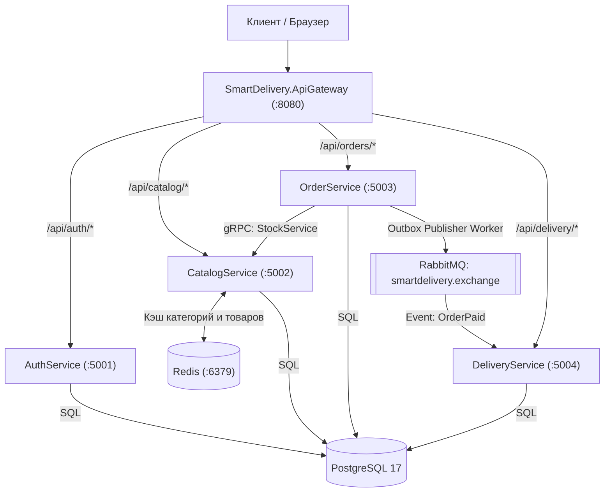

# SmartDelivery — Распределенная система доставки товаров

Студентка: Кабанова Екатерина  
Группа: Разработка WEB-приложений  
Персональный домен: http://kabanovae.9593647-gu32875.twc1.net  
Сервер: 136.234.238.30 (папка /home/kabanovae)  

---

## 1. Обзор архитектуры

Проект представляет собой распределенную микросервисную платформу для оформления и доставки заказов (SmartDelivery). Архитектура построена по принципам Domain-Driven Design (DDD) и Чистой архитектуры (Clean Architecture).

```
                       ┌─────────────────────────┐
                       │       HTTP Client       │
                       └────────────┬────────────┘
                                    │
                                    ▼ :8080
                       ┌─────────────────────────┐
                       │  SmartDelivery.Gateway  │
                       └────────────┬────────────┘
                                    │
            ┌───────────────────────┼───────────────────────┐
            │                       │                       │
      :5001 │                 :5002 │                 :5003 │
┌───────────▼───────────┐ ┌─────────▼─────────────┐ ┌───────▼─────────────┐
│ 1. AuthService        │ │ 2. CatalogService     │ │ 3. OrderService     │
│ (Identity & Access)   │ │ (Каталог и склад)     │ │ (Заказы и сага)     │
│                       │ │                       │ │                     │
│ - User (Root)         │ │ - Product (Root)      │ │ - Order (Root)      │
│ - RefreshToken (Root) │ │ - Category (Root)     │ │ - OrderItem (Entity)│
│ - UserAuditLog (Root) │ │ - InventoryItem (Root)│ │ - Payment (Root)    │
│                       │ │ - Warehouse (Root)    │ │ - SagaState (Root)  │
└───────────────────────┘ └─────────▲─────────────┘ │ - OutboxMessage(Ent)│
                                    │               └───────┬─────────────┘
                                    │ gRPC (Stock)          │
                                    └───────────────────────┤
                                                            │ RabbitMQ
                                                            │ ("smartdelivery.exchange")
                                                            ▼
                                                    ┌─────────────────────┐
                                                    │ 4. DeliveryService  │
                                                    │ (Курьерская доставка│
                                                    │                     │
                                                    │ - DeliveryTask(Root)│
                                                    │ - Courier (Root)    │
                                                    │ - DeliveryRoute(Ent)│
                                                    │ - InboxMessage(Ent) │
                                                    └─────────────────────┘
```



### Стек технологий:
- Язык: C# (.NET 8 / ASP.NET Core)
- База данных: PostgreSQL 17 (Entity Framework Core, Npgsql)
- Кэширование: Redis 7 (IDistributedCache, Cache-Aside)
- Очередь сообщений: RabbitMQ 3.13 (Topic Exchange)
- Синхронный RPC: gRPC (HTTP/2, Protobuf v3)
- Аутентификация: JWT (Access Token + Refresh Token + BCrypt)
- Паттерны: Saga Orchestration с компенсацией, Transaction Outbox, Transaction Inbox

---

## 2. DDD: Ограниченные контексты и агрегаты (15 объектов)

В соответствии с требованиями (10–15 объектов системы) выделено **4 ограниченных контекста** и **15 агрегатов и сущностей**:

### 1. Identity & Access Context (AuthService)
1. **User** (Aggregate Root) — учетная запись пользователя (id, username, email, password_hash, role).
2. **RefreshToken** (Aggregate Root) — сессия обновления JWT токена со сроком жизни и признаком отзыва.
3. **UserAuditLog** (Aggregate Root) — журнал безопасности и аудита входов в систему.

### 2. Catalog & Inventory Context (CatalogService)
4. **Product** (Aggregate Root) — товар каталога (id, name, description, price, category_id, status).
5. **Category** (Aggregate Root) — категория товаров с поддержкой иерархии.
6. **InventoryItem** (Aggregate Root) — складской остаток (product_id, available_quantity, reserved_quantity). Инкапсулирует операции бронирования (`TryReserve`) и освобождения (`Release`).
7. **Warehouse** (Aggregate Root) — склад хранения товаров (id, code, name, address).

### 3. Order & Billing Context (OrderService)
8. **Order** (Aggregate Root) — заказ клиента (id, customer_id, address, total_amount, status).
9. **OrderItem** (Entity) — строка заказа с товаром, количеством и ценой.
10. **Payment** (Aggregate Root) — транзакция оплаты заказа (id, order_id, amount, status).
11. **OrderSagaState** (Aggregate Root) — состояние шагов распределенной транзакции оформления заказа.
12. **OutboxMessage** (Entity) — запись Transaction Outbox для надежной отправки событий в шину.

### 4. Delivery & Logistics Context (DeliveryService)
13. **DeliveryTask** (Aggregate Root) — задание на доставку оплаченного заказа курьеру.
14. **Courier** (Aggregate Root) — курьер (id, name, phone, vehicle_type, status, current_zone).
15. **DeliveryRoute** (Entity) — маршрутный лист курьера со списком адресов доставки.
16. **InboxMessage** (Entity) — ключ дедупликации паттерна Transaction Inbox для гарантии идемпотентности.

---

## 3. Реализация всех 14 пунктов задания

### 1. Выбор предметной области (10–15 агрегатов)
Выбрана система доставки товаров SmartDelivery. Выделено 4 ограниченных контекста и 15 агрегатов.

### 2. Расписание объектов и контекстов по DDD
В каждом микросервисе в папке `Domain` реализованы агрегаты с инвариантами. Например, `InventoryItem` не позволяет зарезервировать больше товара, чем есть на складе, а `Order` управляет переходом по статусам.

### 3. Микросервисы с REST API по чистой архитектуре
5 микросервисов (`AuthService`, `CatalogService`, `OrderService`, `DeliveryService`, `ApiGateway`). В каждом проекте выделены слои: `Domain/`, `Application/`, `Infrastructure/`, `Controllers/`.

### 4. Docker контейнеры и docker compose
Создан multi-stage `Dockerfile` для сборки образов и `compose.yaml`, запускающий все микросервисы, PostgreSQL 17, Redis 7, RabbitMQ 3.13 и подключающийся к сети `nginx-proxy`.

### 5. Кэширование данных в Redis
В `CatalogService` реализован паттерн Cache-Aside: метод `GetProductByIdAsync` и `GetProductsAsync` проверяют Redis перед запросом к БД. При обновлении товара метод `InvalidateCacheAsync` очищает кэш.

### 6. Подключение и работа с PostgreSQL
Использован Entity Framework Core с провайдером `Npgsql`. Схема базы данных генерируется автоматически при запуске контейнеров через `EnsureCreated()`.

### 7. Распределенная транзакция (Saga Orchestration)
В `OrderService` класс `OrderSagaOrchestrator` выполняет шаги:
1. Запрос в CatalogService по gRPC на резервирование товара.
2. Проведение платежа.
3. Компенсация: если оплата не прошла (например, карта отклонена), вызывается компенсирующий метод `ReleaseStockAsync`, который снимает бронь и возвращает товар на склад.
4. При успешной оплате заказ подтверждается и записывается в Outbox.

### 8. Transaction Outbox и Transaction Inbox
- Outbox: в `OrderService` событие `OrderPaidIntegrationEvent` пишется в таблицу `outbox_messages` в единой SQL-транзакции с заказом. Фоновый воркер `OutboxPublisherWorker` досылает сообщения в RabbitMQ.
- Inbox: в `DeliveryService` воркер проверяет таблицу `inbox_messages` по `EventId`. Повторные сообщения отбрасываются, исключая дублирование доставок.

### 9. Подключение шины данных RabbitMQ
Брокер RabbitMQ с Topic-обменником `smartdelivery.exchange`. OrderService отправляет события в routing key `order.paid`, а DeliveryService слушает очередь `smartdelivery.delivery.orderpaid`.

### 10. gRPC для межсервисных вызовов
Контракт `proto/stock.proto`: методы `CheckAndReserveStock` и `ReleaseStock`. CatalogService реализует сервер gRPC, OrderService вызывает его по протоколу HTTP/2 для быстрой синхронной проверки остатков в Саге.

### 11. Единый сервис авторизации с JWT
`AuthService` хеширует пароли с солью через BCrypt и выдает JWT access/refresh токены. Поддерживаются роли `Customer`, `Courier`, `Seller`, `Manager`, `Admin`. Эндпоинты защищены атрибутом `[Authorize]`.

### 12. Юнит-тесты и интеграционные тесты
Проекты `SmartDelivery.UnitTests` (15 тестов на Сагу, компенсацию, остатки, JWT) и `SmartDelivery.IntegrationTests` (7 тестов REST API через WebApplicationFactory). Всего 22 теста, все успешно проходят (100% PASS).

### 13. Пайплайн в GitLab CI для тестов
В `.gitlab-ci.yml` первой стадией настроен `test-job`, который запускает `dotnet test` и публикует отчет JUnit XML в GitLab.

### 14. Сборка и деплой на сервер преподавателя
Стадия `deploy-production` по SSH деплоит `compose.yaml` в `/home/kabanovae` на сервере `136.234.238.30`. Сервисы подключаются к Nginx Proxy Manager по домену `kabanovae.9593647-gu32875.twc1.net`.

---

## 4. Локальный запуск и тестирование

### Запуск тестов:
```powershell
dotnet test SmartDelivery.sln
```

### Запуск микросервисов:
- AuthService: запуск через ярлык `1_Запустить_AuthService.bat` или команду:
  ```powershell
  dotnet run --project src/Services/Auth/SmartDelivery.AuthService --launch-profile http
  ```
  Swagger доступен по адресу: http://localhost:5125/swagger

- CatalogService: запуск через ярлык `2_Запустить_CatalogService.bat` или команду:
  ```powershell
  dotnet run --project src/Services/Catalog/SmartDelivery.CatalogService --launch-profile http
  ```
  Swagger доступен по адресу: http://localhost:5034/swagger

### Запуск всей системы через Docker Compose:
```powershell
docker compose up -d
```
После запуска шлюз доступен на http://localhost:8080.
